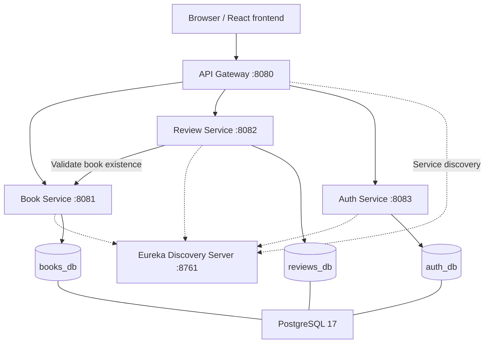

# BookNest

BookNest is a full-stack book catalog and review application built as a Java/Spring Boot microservices system with a React and TypeScript frontend. It demonstrates service discovery, API routing, inter-service communication, JWT authentication, role-based access control, persistence, caching, fault-tolerance patterns, automated tests, and Docker-based deployment.

## Features

- Browse books, view book details, and search by title or author.
- View book reviews and average ratings.
- Register, sign in, and sign out through the web interface.
- Submit reviews as an authenticated user.
- Manage books through administrative API operations.
- Restrict review deletion to administrators.
- Automatically populate an empty book catalog with five sample books.
- Run backend unit and application-context tests using one script.

## Technology stack

| Layer                | Technologies                                                                 |
| -------------------- | ---------------------------------------------------------------------------- |
| Frontend             | React, TypeScript, Vite, Zustand                                             |
| Backend              | Java 17, Spring Boot, Spring Web MVC, Spring Data JPA, Spring Security       |
| Microservices        | Spring Cloud Netflix Eureka, Spring Cloud Gateway, Spring Cloud LoadBalancer |
| Authentication       | JWT (HS256)                                                                  |
| Database             | PostgreSQL 17                                                                |
| Caching / resilience | Caffeine, Resilience4j                                                       |
| Testing              | JUnit 5, Mockito, Maven Wrapper                                              |
| Deployment           | Docker, Docker Compose                                                       |

## Architecture



Eureka provides service registration and discovery; it is **not** in the HTTP request path. All three logical databases run in one PostgreSQL container, while each service owns its own database.

For additional information, see [Architecture](docs/architecture.md).

## Repository structure

```text
booknest/
├── docker-compose.yml
├── .env.example
├── run-tests.sh
├── docker/postgres/init/      # Additional database initialization
├── frontend/                  # React application
├── services/
│   ├── discovery-server/
│   ├── api-gateway/
│   ├── book-service/
│   ├── review-service/
│   └── auth-service/
└── docs/
    ├── architecture.md
    ├── api.md
    └── testing.md
```

## Prerequisites

For running the application:

- Docker Desktop (or Docker Engine with Docker Compose v2).
- Git, or a downloaded ZIP archive of the repository.
- Available host ports **3000**, **8080**, **8761**, and **5433**.

For running backend tests on the host:

- Java **17** and a working Java installation (`java -version`).
- Bash (macOS/Linux, Git Bash, or WSL on Windows).
- Docker with Docker Compose v2.
- Maven does not need to be installed separately; each service includes its Maven Wrapper.

## Getting started

### 1. Obtain the project

Clone the repository or download and extract its ZIP archive. Open a terminal in the `booknest` root directory (the directory containing `docker-compose.yml`).

### 2. Configure environment variables

```bash
cp .env.example .env
```

Edit `.env`:

```dotenv
DB_USERNAME=booknest
DB_PASSWORD=choose-a-local-password
JWT_SECRET=replace-with-generated-base64-secret
```

Generate a random 32-byte JWT signing key and paste the output as `JWT_SECRET`:

```bash
openssl rand -base64 32
```

The signing key must be the **same** for the authentication service and services that verify JWTs. Do not commit `.env` or share a real secret.

### 3. Start the application

```bash
docker compose up -d --build
```

The initial build can take several minutes. The PostgreSQL container initializes `books_db`, `reviews_db`, and `auth_db` on its first run. The Book Service seeds five sample books if its catalog is empty. Service discovery and application startup may take additional time after containers enter the `Up` state.

### 4. Open the application

| Component        | Address                            |
| ---------------- | ---------------------------------- |
| React frontend   | http://localhost:3000              |
| API Gateway      | http://localhost:8080              |
| Eureka dashboard | http://localhost:8761              |
| Books endpoint   | http://localhost:8080/api/v1/books |

Backend services communicate over the Docker network; their internal ports are not published to the host.

### 5. Verify the installation

```bash
docker compose ps
curl -i http://localhost:8080/api/v1/books
```

Expect seven running containers, PostgreSQL marked `healthy`, and an HTTP `200` response containing the initial books. If the API is briefly unavailable, wait for service registration and retry.

In the browser, register a user, sign in, open a book, submit a review, and sign out. Anonymous users should still be able to browse books and read reviews.

### 6. Stop the application

```bash
docker compose down
```

This preserves PostgreSQL data. **Do not use `docker compose down -v` unless you deliberately want to delete the application's databases.**

## Authentication and authorization

The authentication service provides registration and login endpoints. Login returns a JWT; send it with protected requests:

```http
Authorization: Bearer <access-token>
```

The JWT contains a user ID (`sub`), email, role, issue time, and expiration time. Tokens expire after **one hour** under the provided configuration.

New registrations receive the `USER` role. Administrative operations require an existing `ADMIN` account; there is no public admin registration endpoint. See [API documentation](docs/api.md) for the role requirements.

## API overview

All requests below use the API Gateway at `http://localhost:8080`.

| Method   | Path                          | Purpose                  |
| -------- | ----------------------------- | ------------------------ |
| `POST`   | `/api/v1/auth/register`       | Register a user          |
| `POST`   | `/api/v1/auth/login`          | Sign in and obtain a JWT |
| `GET`    | `/api/v1/books`               | List/search books        |
| `GET`    | `/api/v1/books/{id}`          | Retrieve a book          |
| `POST`   | `/api/v1/books`               | Create a book            |
| `PUT`    | `/api/v1/books/{id}`          | Update a book            |
| `DELETE` | `/api/v1/books/{id}`          | Delete a book            |
| `GET`    | `/api/v1/reviews?bookId={id}` | List reviews for a book  |
| `POST`   | `/api/v1/reviews`             | Create a review          |
| `DELETE` | `/api/v1/reviews/{id}`        | Delete a review          |

For request examples, response codes, and authorization rules, see [REST API](docs/api.md).

## Automated tests

From the repository root:

```bash
./run-tests.sh
```

The script loads `.env`, checks Docker Compose, starts PostgreSQL if necessary, and runs Maven tests for `book-service`, `review-service`, and `auth-service`. It stops on the first failure.

The latest verified test run contained **31 passing backend tests** across the three services. Results can change when code or tests are updated.

On macOS/Linux, `run-tests.sh` should retain its executable Git permission (`100755`). If executing from an extracted archive where permissions were lost, use:

```bash
bash run-tests.sh
```

See [Testing guide](docs/testing.md) for test scope and a manual verification checklist.

## Troubleshooting

**Docker Compose not available:** Check `docker compose version` and make sure Docker Desktop/Engine is running.

**Port already in use:** Stop the other application using ports 3000, 8080, 8761, or 5433, or adjust the published host ports in `docker-compose.yml`.

**JWT-related startup or authentication errors:** Ensure `.env` exists, `JWT_SECRET` is a valid Base64-encoded 32-byte key, and all services receive the same value through Compose.

**Database missing on first startup:** Inspect `docker compose logs postgres`. Database creation scripts in `docker/postgres/init/` run only when PostgreSQL initializes a **new empty data volume**.

**Gateway returns a temporary error:** Allow time for Eureka registration, then inspect `docker compose ps` and the affected service logs.

**Tests fail because of missing configuration:** Run the root `run-tests.sh` script rather than invoking Maven without the environment variables it requires.

## Documentation

- [Architecture and service responsibilities](docs/architecture.md)
- [REST API reference](docs/api.md)
- [Automated and manual testing](docs/testing.md)

## Academic project

BookNest is a university project demonstrating the design, implementation, deployment, and testing of a microservices-based web application.
