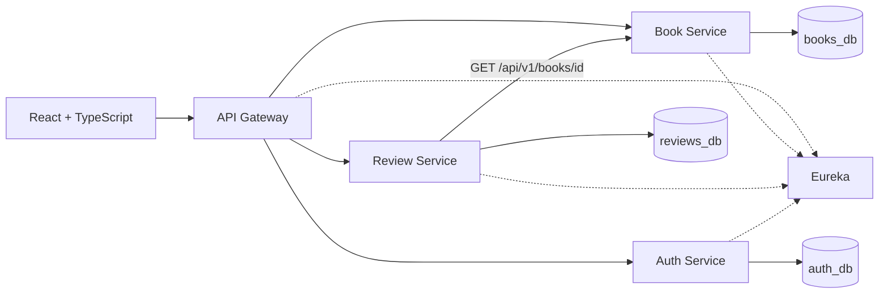

# BookNest Architecture

## Overview

BookNest is organized into independently deployed backend services, a browser frontend, and a shared PostgreSQL server with **separate databases per domain**. Docker Compose builds and runs the complete system locally.

Eureka is a **service registry**, not a request proxy. The gateway discovers registered services and forwards requests to the appropriate backend.

## Components

| Component | Internal port | Responsibility |
| --- | ---: | --- |
| Frontend | 80 (host 3000) | Book catalog, details, reviews, authentication UI |
| API Gateway | 8080 | Public backend entry point and routing |
| Discovery Server | 8761 | Eureka service registration/discovery |
| Book Service | 8081 | Book catalog, search, CRUD, sample-data initialization |
| Review Service | 8082 | Review listing, creation, deletion; book existence checks |
| Auth Service | 8083 | User registration, password verification, JWT issuance |
| PostgreSQL | 5432 (host 5433) | Three logical databases: `books_db`, `reviews_db`, `auth_db` |

Only ports 3000, 8080, 8761, and 5433 are published on `127.0.0.1` in the provided Compose configuration.

## Request flows

### Browse books

1. The frontend requests `GET /api/v1/books` from the API Gateway.
2. The gateway routes the request to Book Service.
3. Book Service queries its repository and returns JSON.

### Create a review

1. An authenticated user submits a review with a Bearer token.
2. The gateway routes `POST /api/v1/reviews` to Review Service.
3. Review Service validates the JWT and the user's role.
4. Review Service calls Book Service using a load-balanced `RestClient` to check whether the referenced book exists.
5. If the book exists, Review Service saves the review in `reviews_db` and returns HTTP `201`. If it does not, the service rejects the request with HTTP `400`.

### Sign in

1. The frontend submits credentials to `POST /api/v1/auth/login`.
2. Auth Service loads the user from `auth_db` and verifies the password hash.
3. Auth Service signs an HS256 JWT containing the user's ID, email, and role.
4. The frontend stores the token for the browser session and sends it in protected API requests.
5. Resource services verify JWT signatures using the configured shared secret.

## Data and initialization

- `books_db` is created using `POSTGRES_DB`.
- `reviews_db` and `auth_db` are created by the SQL initialization file under `docker/postgres/init/` on first database-volume initialization.
- JPA/Hibernate manages application tables using the configured `ddl-auto: update` setting.
- Book Service uses a `CommandLineRunner` to insert five sample books when the catalog is empty.
- Data persists in the named Docker volume `postgres_data` across normal container restarts and `docker compose down`.

The current setup is intended for local development and academic demonstration. For production, database migrations, independent credentials, stricter secret management, and stronger deployment health checks would be appropriate.

## Cross-cutting concerns

**Authentication:** Auth Service issues JWTs; protected resource endpoints enforce roles. Public registration assigns `USER`, not `ADMIN`.

**Caching:** Book Service uses Caffeine for book lookup caching, configured with a maximum of 100 entries and a 10-minute write expiration.

**Resilience:** Review Service includes Resilience4j dependencies and uses service-to-service calls. The project has exercised a circuit-breaker/recovery scenario; see implementation configuration for the exact fallback and thresholds before changing them.

**Service readiness:** Docker Compose starts dependent services in order but `service_started` does not guarantee application readiness. Allow a short startup period for Eureka registration and routing.

## Security and deployment notes

- Keep `.env` out of Git; commit only `.env.example`.
- Use a cryptographically random Base64-encoded 32-byte JWT secret.
- All services that issue or validate tokens must agree on the signing key.
- Publicly exposing Eureka, the database, or development-only endpoints is not recommended.
- The frontend is served through its Docker container on host port 3000.
